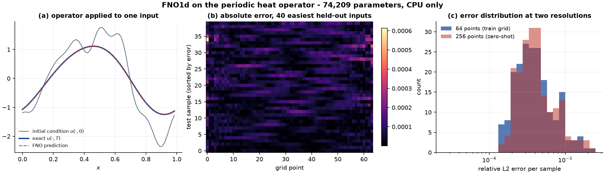
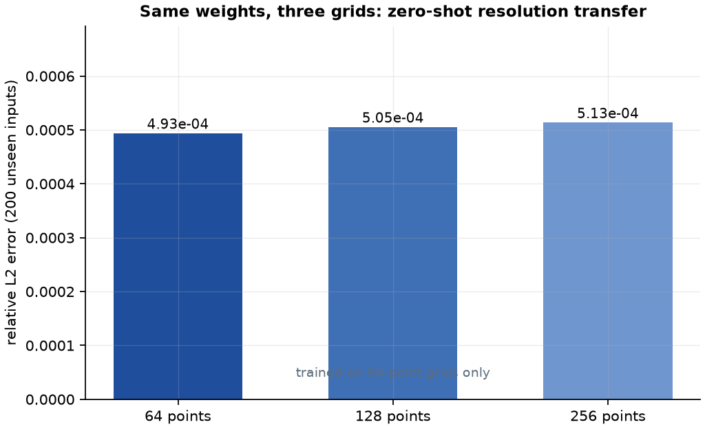
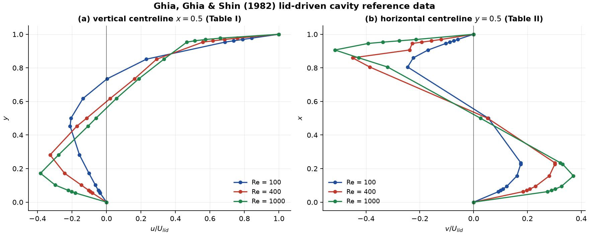
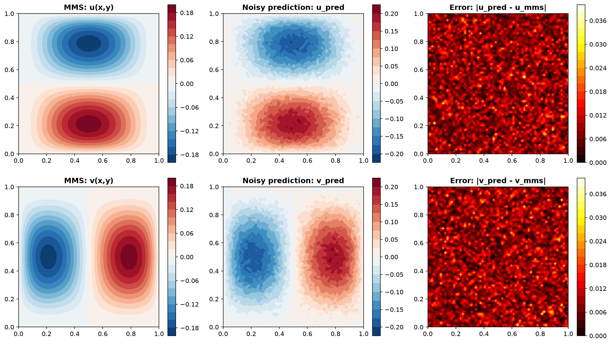

# Physics Surrogate Benchmarks

[](https://github.com/elmoutaouakiltarik-web/physics-surrogate-benchmarks/actions/workflows/tests.yml)
[](LICENSE)
[](https://www.python.org/downloads/)
[](https://pytorch.org/)
[](https://github.com/astral-sh/ruff)

Two surrogate-model families, each scored against a **closed-form solution**, so the
reported error is the error of the model and not the error of a solver:

| Model | Problem | Reference | Held-out result |
|---|---|---|---|
| **PINN** | 1D viscous Burgers, ν = 0.01/π | Cole–Hopf exact solution | rel. L2 **2.54e-2**, R² **0.99936** at t = 0.5 |
| **FNO** (Fourier Neural Operator) | periodic heat operator u(·,0) → u(·,T) | exact Fourier-space solution | rel. L2 **4.93e-4** on the training grid, **5.13e-4** zero-shot on a 4× finer grid |
| **FNO vs MLP** | *nonlinear* periodic Burgers operator (ν = 0.02, T = 0.5) | validated pseudo-spectral solver (numerical) | FNO rel. L2 **6.6e-3 ± 0.3e-3** (3 seeds), unchanged zero-shot on a 4× finer grid; dense MLP **6.7e-2** |

Everything runs on a laptop CPU. The committed runs were produced on an Intel Ice Lake
mobile CPU, Windows 10, Python 3.11.9, PyTorch 2.12.0+cpu; raw outputs are in
[`benchmarks/`](benchmarks) and the weights in [`weights/`](weights).

**What this is not.** One of the two tasks (FNO/heat) is linear and diagonal in the basis
the spectral layer uses, so it is an easy problem by construction: it verifies the
implementation and the resolution-invariance property, not the accuracy of neural
operators on turbulent flow. The PINN result is a single seeded run on a smooth 1D
problem. Both limitations are measured below rather than smoothed over.

## Install

```bash
git clone https://github.com/elmoutaouakiltarik-web/physics-surrogate-benchmarks.git
cd physics-surrogate-benchmarks
python -m venv .venv && source .venv/bin/activate   # Windows: .venv\Scripts\activate
pip install -r requirements.txt
pip install -e .
pytest -q
```

CPU-only PyTorch keeps the install small:

```bash
pip install torch --index-url https://download.pytorch.org/whl/cpu
```

## 1. PINN on Burgers 1D

$$u_t + u\,u_x = \nu\,u_{xx},\qquad x\in[-1,1],\quad t\in[0,1],\quad \nu = 0.01/\pi,\qquad u(x,0) = -\sin(\pi x),\quad u(\pm 1,t)=0$$

- Network: fully connected 2 → 4×64 → 1, tanh, **12,737 parameters**.
- Training: 10,000 collocation points, 256 initial-condition points, 256 boundary points;
  Adam 10,000 epochs, then L-BFGS 3,000 iterations; residual-based adaptive refinement
  (RAR) every 2,000 epochs adds 1,000 high-residual points, ending at 14,000 points.
- Reference: the Cole–Hopf integral, evaluated in log space (the integrand spans ~e⁵⁰).
  It is cross-checked against an independent Fourier pseudo-spectral solve in
  `tests/test_reference_solutions.py`.
- Cost: 1,590 s wall clock on the laptop CPU.

| Test time | Relative L2 | Max abs. error | R² |
|---|---|---|---|
| t = 0.25 | 3.65e-2 | 0.151 | 0.99867 |
| **t = 0.50** | **2.54e-2** | **0.167** | **0.99936** |
| t = 0.75 | 9.61e-2 | 0.622 | 0.99076 |
| t = 1.00 | 1.51e-1 | 0.774 | 0.97719 |


The single number usually quoted for this benchmark is the middle of the time window.
Scored across the whole window the error grows by **6×** towards t = 1, because the
solution steepens into a front that a tanh network with 64 units per layer cannot
resolve: the maximum error sits on the front, while most of the domain stays smooth.
Both rows are reported; only quoting t = 0.5 would hide the interesting part.

```bash
python scripts/run_benchmark_real.py                 # train + score + write JSON (~27 min CPU)
python scripts/run_benchmark_real.py --from-weights  # re-score the committed weights (~2 s)
python scripts/run_benchmark_real.py --quick         # smoke run, does not converge
```

## 2. Fourier Neural Operator on the heat operator

`src/physics_surrogates/models/fno.py` implements FNO1d (Li et al., 2021): lift
(u, x) → 4 spectral layers (16 Fourier modes, width 32) → projection, **74,209
parameters**. It learns the solution operator of

$$u_t = \nu\,u_{xx}\ \text{on } [0,1)\ \text{periodic},\qquad \nu = 0.01,\quad T = 1,$$

whose exact solution is diagonal in Fourier space, so the ground truth has no solver
error at all.

- Train: 1,000 random smooth periodic initial conditions on a 64-point grid, 300 epochs,
  Adam with a cosine schedule, relative-L2 loss (283 s on CPU).
- Test: 200 unseen initial conditions (different seed), evaluated at three resolutions
  **with the same weights**.

| Test grid | Relative L2 |
|---|---|
| 64 (training resolution) | 4.93e-4 |
| 128 | 5.05e-4 |
| 256 | 5.13e-4 |





Zero-shot super-resolution costs about 4 % of the error: the model was never trained on
more than 64 points. That is the property being verified here, and it is a property of
the architecture rather than evidence of accuracy on a hard operator.

```bash
python scripts/benchmark_fno_heat.py     # train + score + write JSON and weights (~4 min)
```

## 3. Reference data: lid-driven cavity (Ghia et al., 1982)

`src/physics_surrogates/datasets/ghia_cavity.py` ships the published centreline profiles
for Re = 100, 400 and 1000:

- Table I — `u(y)` on the vertical centreline x = 0.5 (17 probe locations).
- Table II — `v(x)` on the horizontal centreline y = 0.5 (17 probe locations).



The module also provides the unit-square mesh, wall masks, and
`ghia_centerline_errors()`, which interpolates a computed field onto the published probe
locations and returns the relative L2 error in percent.

**No cavity surrogate is trained here yet.** The data and the comparison helper are
shipped so that the benchmark can be added without re-transcribing anything — and
because a published reference dataset is worth having on its own. Two camera-ready
caveats are recorded in the module: the Re = 400, Table II value at x = 0.9063
(−0.23827) breaks the trend and is widely treated as a misprint, and the x = 0.5 entry
is printed as 0.05188 in some scans and 0.05186 in the PetIBM distribution. Both are kept
as printed and flagged, not silently corrected.

## 4. Verification: manufactured solution



`scripts/run_benchmark_real.py --mms-only` checks the **metric pipeline** on a known
field: the velocity is derived from the stream function
ψ = 16x²(1−x)²y²(1−y)², so it is analytically divergence-free and no-slip on all four
walls. Gaussian noise (σ = 0.01) is added and the metrics are recomputed. This is a
verification artifact, **not** a model result, and it is never quoted in the table above.

## 5. Nonlinear operator learning: FNO vs dense MLP on Burgers

The heat task is linear. Here the operator is nonlinear (shock-forming advection):

$$u_t + u\,u_x = 
u\,u_{xx}\ 	ext{on } [0,1)\ 	ext{periodic},\quad 
u = 0.02,\ T = 0.5,$$

with initial conditions of amplitude 2. There is no closed form for random initial
conditions, so the reference is a pseudo-spectral solver (`src/physics_surrogates/solvers.py`:
2/3-rule dealiasing, integrating-factor RK4). Because it is numerical, `tests/test_solvers.py`
verifies it: RK4-order time convergence, spatial convergence, conservation of the mean,
non-growing energy, and agreement with the exact heat solution in the linear limit (the gap
scales as O(amplitude)). Grid-64 and grid-256 references differ by about 2e-3 relative
(max-norm), well below the model errors below.

Setup: 1,000 training pairs on a 64-point grid, 200 epochs, relative-L2 loss, 3 seeds
(different training data and initialisation), 200 fixed unseen test initial conditions. The
MLP (3×256 hidden, 164,672 parameters) is larger than the FNO (74,209) and only runs on the
64-point grid.

| Model | Test grid 64 | Grid 128 (zero-shot) | Grid 256 (zero-shot) |
|---|---|---|---|
| FNO1d | 6.64e-3 ± 2.9e-4 | 6.62e-3 ± 2.7e-4 | 6.61e-3 ± 2.6e-4 |
| Dense MLP | 6.74e-2 ± 1.9e-3 | n/a (fixed input size) | n/a |
| Heat theory (ignores advection) | 2.17 | 2.17 | 2.17 |
| Identity (predict u(·,0)) | 4.40 | 4.40 | 4.40 |

Mean ± std of the relative L2 error over seeds; the last two rows are reference points,
not trained models.

```bash
python scripts/benchmark_fno_burgers.py   # ~12 min CPU, writes benchmarks/fno_burgers_results.json
```

**Limits.** 1D, periodic, smooth random initial conditions, one (ν, T) pair, three seeds, CPU
only. The error is measured against a numerical reference, not an exact solution. The dense
MLP is a simple baseline and was not tuned. Resolution invariance is shown for finer grids
only; this does not cover non-periodic domains, fronts sharper than the 64-point grid can
resolve, or 2D/3D flows.

## Reproducibility

- **Seeds.** Sections 1-4 are one seeded run per number: treat the third significant digit
  as noise. Section 5 reports mean ± std over 3 seeds.
- **Artifacts.** `benchmarks/*.json` holds the configuration, hardware and metrics of
  each run; the README tables are copies of those files.
- **Weights.** `weights/` holds the exact weights behind the published numbers.
  `--from-weights` re-scores them, and `tests/test_artifacts.py` fails if the JSON, the
  weights and the README drift apart.
- **Figures.** `python scripts/make_figures.py` regenerates every figure in `docs/img`
  from the committed artifacts, with no training.

```bash
pytest -q        # 70 tests: models, datasets, reference cross-checks, artifact consistency
ruff check src tests scripts
```

## Layout

```
src/physics_surrogates/
  reference.py           Cole-Hopf exact solution + independent spectral solver
  models/pinns.py        BurgersPINN (Adam + L-BFGS + RAR)
  models/fno.py          SpectralConv1d, FNO1d, exact heat operator, train/eval
  models/burgers_operator.py  nonlinear Burgers dataset, MLP baseline, train/eval
  solvers.py             pseudo-spectral Burgers solver for random initial conditions
  datasets/ghia_cavity.py  published Ghia tables, mesh/BC/MMS helpers, centreline errors
scripts/
  run_benchmark_real.py    Burgers PINN + MMS check (single canonical entry point)
  benchmark_fno_heat.py    FNO heat operator
  benchmark_fno_burgers.py FNO vs MLP on nonlinear Burgers (3 seeds)
  make_figures.py          all figures from committed artifacts
benchmarks/                JSON results (committed)
weights/                   trained weights (committed)
docs/img/                  figures
tests/                     pytest suite
```

## References

- Raissi, Perdikaris, Karniadakis (2019). Physics-informed neural networks. *J. Comput. Phys.* 378, 686–707.
- Li et al. (2021). Fourier Neural Operator for Parametric Partial Differential Equations. *ICLR*. arXiv:2010.08895.
- Ghia, Ghia, Shin (1982). High-Re solutions for incompressible flow using the Navier–Stokes equations and a multigrid method. *J. Comput. Phys.* 48(3), 387–411.
- Basdevant, Deville, Haldenwang, Lacroix, Ouazzani, Peyret, Orlandi, Patera (1986). Spectral and finite difference solutions of the Burgers equation. *Computers & Fluids* 14(1), 23–41.

## License

MIT — see [LICENSE](LICENSE). Citation metadata in [CITATION.cff](CITATION.cff).
