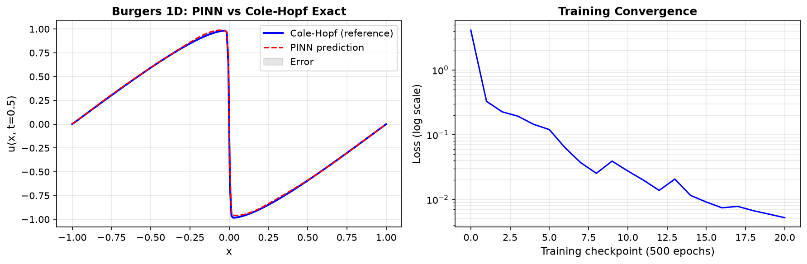

# Physics Surrogate Benchmarks

[](https://github.com/elmoutaouakiltarik-web/physics-surrogate-benchmarks/actions)
[](LICENSE)
[](https://www.python.org/downloads/)
[](https://pytorch.org/)

Small, auditable PyTorch implementations of two surrogate-model families, each checked against an **exact analytical reference** so the reported error is the model's error and nothing else:

| Model | Problem | Reference | Result (held-out) |
|---|---|---|---|
| **PINN** | 1D viscous Burgers, ν = 0.01/π | Cole–Hopf exact solution | rel. L2 **2.5e-2**, R² **0.9994** |
| **FNO** (Fourier Neural Operator) | 1D periodic heat operator u(·,0) → u(·,T) | exact Fourier-space solution | rel. L2 **4.9e-4** at train grid, **5.1e-4** zero-shot on 4× finer grid |

Everything runs on a laptop CPU. Numbers below were produced on an Intel i5 (Ice Lake), Windows, Python 3.11, PyTorch 2.12 CPU; raw outputs are committed in `benchmarks/*.json`.

## Install

```bash
git clone https://github.com/elmoutaouakiltarik-web/physics-surrogate-benchmarks.git
cd physics-surrogate-benchmarks
python -m venv .venv && source .venv/bin/activate   # Windows: .venv\Scripts\activate
pip install -r requirements.txt
pip install -e .
pytest -q
```

## 1. PINN on Burgers 1D

$$u_t + u\,u_x = \nu\,u_{xx},\quad x\in[-1,1],\ t\in[0,1],\ \nu = 0.01/\pi,\quad u(x,0) = -\sin(\pi x)$$

- Network: fully connected 2 → 4×64 → 1, tanh.
- Training: 10,000 collocation points, 100 IC + 100 BC points, Adam 10,000 epochs then L-BFGS 3,000 iterations, residual-based adaptive refinement (RAR) every 2,000 epochs.
- Validation: 200 test points against the Cole–Hopf exact solution.

| Metric | Value |
|---|---|
| Relative L2 error | 0.0254 |
| R² | 0.99936 |
| Max absolute error | 0.167 (at the shock near x = 0) |
| Training time (CPU) | 1,590 s |
| Weights | `weights/burgers_pinn.pt`, 0.05 MB |



```bash
python scripts/run_benchmark_real.py      # writes benchmarks/burgers_1d_results.json
```

The max error sits on the steep front, which is the known weak spot of vanilla PINNs; the mean error is low because most of the domain is smooth.

## 2. Fourier Neural Operator on the heat operator

`src/physics_surrogates/models/fno.py` implements FNO1d (Li et al., 2021): lift (u, x) → 4 spectral layers (16 Fourier modes, width 32) → projection; 74,209 parameters. It learns the solution operator of

$$u_t = \nu\,u_{xx}\ \text{on } [0,1)\ \text{periodic},\quad \nu = 0.01,\ T = 1,$$

whose exact solution is diagonal in Fourier space, so the ground truth has no solver error.

- Train: 1,000 random smooth periodic initial conditions on a 64-point grid, 300 epochs, Adam + cosine schedule, relative-L2 loss (252 s on CPU).
- Test: 200 unseen initial conditions, evaluated at three resolutions **with the same weights**.

| Test grid | Relative L2 |
|---|---|
| 64 (training resolution) | 4.93e-4 |
| 128 | 5.05e-4 |
| 256 | 5.13e-4 |

```bash
python scripts/benchmark_fno_heat.py      # writes benchmarks/fno_heat_results.json
```

**Read this honestly:** the heat operator is linear and diagonal in Fourier space, which is exactly what an FNO layer can represent, so this is an easy task. It verifies the implementation and the resolution-invariance property; it is not evidence of FNO accuracy on nonlinear or turbulent flows.

## What is and is not here

- `datasets/ghia_cavity.py` ships the Ghia et al. (1982) lid-driven-cavity reference profiles (Re = 100, 400, 1000) and mesh/BC helpers. **No cavity surrogate has been trained against them yet**; that is the next benchmark.
- `scripts/benchmark_cavity_burgers.py` also writes `benchmarks/mms_cavity_results.json`. That file checks the metric pipeline on a manufactured solution plus synthetic noise. It is **not** a model result and is not quoted above.
- No GPU, no multi-run statistics yet: each number is one seeded run.

## Layout

```
src/physics_surrogates/
  models/pinns.py        BurgersPINN (Adam + L-BFGS, RAR)
  models/fno.py          SpectralConv1d, FNO1d, exact heat operator, training/eval
  datasets/ghia_cavity.py
scripts/                 benchmark entry points
benchmarks/              JSON results (committed)
docs/img/                plots
tests/                   pytest suite (models, datasets, FNO)
```

## Tests

```bash
pytest -q
```

The FNO test trains a small model for 60 epochs (about 30 s on CPU) and asserts error < 5% on the training grid and < 10% zero-shot on a 4× finer grid.

## References

- Raissi, Perdikaris, Karniadakis (2019). Physics-informed neural networks. *J. Comput. Phys.* 378.
- Li et al. (2021). Fourier Neural Operator for Parametric Partial Differential Equations. *ICLR*. arXiv:2010.08895.
- Ghia, Ghia, Shin (1982). High-Re solutions for incompressible flow using the Navier–Stokes equations and a multigrid method. *J. Comput. Phys.* 48.

## License

MIT — see [LICENSE](LICENSE). Citation metadata in [CITATION.cff](CITATION.cff).
